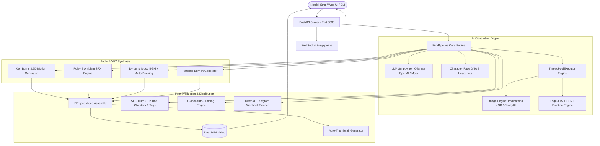

# 🎬 AI Film Studio - Next-Gen Autonomous AI Cinema Engine

> **Hệ thống sản xuất phim tự động từ kịch bản đến sản phẩm hoàn thiện** được hỗ trợ bởi AI: Tạo kịch bản 3 Hồi điện ảnh, sinh hình ảnh theo DNA nhân vật nhất quán, thuyết minh cảm xúc chuẩn SSML, hiệu ứng chuyển động Ken Burns 2.5D, hòa âm đa tầng (Voice + Foley SFX + Dynamic Mood BGM), Hardsub karaoke/cinema, Timeline Scrubber tương tác, lồng tiếng quốc tế 1-Click, tự tạo Thumbnail & SEO Hub, và thông báo Webhook tự động.

---

## 📑 Mục lục
1. [Tính năng nổi bật (Feature Matrix)](#-tính-năng-nổi-bật-feature-matrix)
2. [Kiến trúc hệ thống](#-kiến-trúc-hệ-thống)
3. [Yêu cầu hệ thống](#-yêu-cầu-hệ-thống)
4. [Hướng dẫn cài đặt & Cách chạy tool](#-hướng-dẫn-cài-đặt--cách-chạy-tool)
   - [Cách 1: Khởi chạy Web UI qua Docker (Khuyên dùng)](#cách-1-khởi-chạy-web-ui-qua-docker-khuyên-dùng)
   - [Cách 2: Chạy qua giao diện dòng lệnh (CLI)](#cách-2-chạy-qua-giao-diện-dòng-lệnh-cli)
   - [Cách 3: Chạy Native Môi trường Development](#cách-3-chạy-native-môi-trường-development)
5. [Cấu hình môi trường (.env)](#-cấu-hình-môi-trường-env)
6. [Tài liệu REST API & WebSocket](#-tài-liệu-rest-api--websocket)
7. [Kiểm thử & Đảm bảo chất lượng (Quality Assurance)](#-kiểm-thử--đảm-bảo-chất-lượng)

---

## 🚀 Tính năng nổi bật (Feature Matrix)

### 1. Kịch bản & Điện ảnh (Cinematic Screenplay)
- **Cấu trúc 3 Hồi điện ảnh (3-Act Structure):** Kịch bản tự động phân chia nhịp độ kịch bản gồm Hồi 1 (Mở đầu / Giới thiệu thế giới), Hồi 2 (Xung đột / Cao trào), Hồi 3 (Giải quyết / Hậu quả).
- **Chế độ Sản xuất Phim Dài tập (Series Mode):** Cho phép tạo tập tiếp theo thừa hưởng toàn bộ nhân vật, visual seed, style art và bối cảnh từ tập trước đó.
- **Đa định dạng khung hình (Aspect Ratios):** Hỗ trợ chuẩn **16:9 Landscape** (YouTube, TV, Cinema) và **9:16 Portrait** (TikTok, YouTube Shorts, Facebook Reels).

### 2. Nhân vật & Nhất quán Visual (Character DNA & Visual Consistency)
- **Character DNA Prompting:** Tự động trích xuất đặc điểm nhân dạng chi tiết (khuôn mặt, trang phục, màu mắt, kiểu tóc) đưa vào prompt từng khung hình.
- **Headshot Portrait Gallery:** Tạo ảnh chân dung mẫu 1-click hoặc tải ảnh khuôn mặt từ máy tính lên để làm tài liệu tham chiếu (Reference Board).
- **Seed Consistency & Style Lock:** Duy trì visual style nhất quán (Cyberpunk, Anime, Photorealistic, Ghibli, 3D Render,...).

### 3. Hòa âm Đa tầng & Thuyết minh Cảm xúc (Audio & Voice Engineering)
- **Acoustic SSML Emotion Modulation:** Tự động điều chỉnh cao độ (pitch), tốc độ (rate) và âm lượng (volume) theo trạng thái tâm lý nhân vật (excited, tense, sad, whispering, epic, calm,...).
- **Hòa âm 3 lớp (3-Layer Audio Mixing):**
  - **Voice Track:** Thuyết minh chuẩn AI Edge-TTS hoặc ElevenLabs.
  - **Dynamic Mood BGM Track:** Nhạc nền tự động chọn theo tông màu cảm xúc của phim kèm tính năng Auto-Ducking (giảm nhạc khi có giọng nói).
  - **Foley & Ambient SFX:** Tự động nhận diện cảnh quay để chèn âm thanh môi trường (tiếng mưa, bước chân, sấm sét, gió rít, tiếng vũ khí va chạm,...).
- **Global Auto-Dubbing (Lồng tiếng Quốc tế 1-Click):** Dịch và xuất bản toàn bộ phim sang 8 ngôn ngữ phổ biến (Tiếng Việt, Anh, Nhật, Hàn, Pháp, Đức, Tây Ban Nha, Trung Quốc) kèm hiệu chỉnh đồng bộ thời gian.

### 4. Hiệu ứng Hình ảnh & Dựng phim (VFX & Post-Production)
- **Hiệu ứng Ken Burns 2.5D:** Biến ảnh tĩnh thành cảnh quay sống động với camera chuyển động mượt mà (Zoom In, Zoom Out, Pan Left, Pan Right, Static).
- **Hardsub Burn-in Engine:** Tự động tạo phụ đề ASS/SRT chuẩn điện ảnh, viền đổ bóng vàng/trắng hoặc karaoke, tự động gắn cố định vào khung hình video.
- **Timeline Scrubber tương tác:** Bảng điều khiển dòng thời gian đa tầng (Video Preview, Shot Blocks, Voice Audio Wave, SFX/BGM Track) cho phép nhảy trực tiếp đến từng giây/shot trong phim.
- **Storyboard Editor toàn diện:** Thêm cảnh mới, xóa cảnh thừa, đảo thứ tự, đổi giọng từng nhân vật, đổi hiệu ứng chuyển động, Reroll sinh lại ảnh hoặc tải ảnh tùy chỉnh lên.

### 5. Tối ưu Phát hành & Tự động hóa (Publishing & Automation)
- **Auto-Thumbnail Generator:** Tự động chọn khung hình đẹp nhất của cảnh cao trào, áp bộ lọc tương phản và phủ huy hiệu tiêu đề điện ảnh sắc nét (1280x720).
- **1-Click SEO Hub:** Tự động sinh 5 tiêu đề YouTube chuẩn CTR cao, mô tả video kèm Timeline Chapters tự động đánh số giây và bộ từ khóa/hashtag viral.
- **WebSocket Real-time Streaming:** Giám sát trực tiếp 100% tiến độ render, log hệ thống và chỉ số FPS thời gian thực qua giao thức `/ws/pipeline`.
- **Thông báo Webhook mạng xã hội:** Tự động bắn thông báo kèm kết quả render lên Discord, Telegram hoặc Custom HTTP Webhook Server ngay khi phim hoàn tất.

---

## 🏛 Kiến trúc hệ thống



---

## 💻 Yêu cầu hệ thống

- **Hệ điều hành:** Linux (Ubuntu 20.04+, Debian, Fedora, Arch) hoặc macOS, Windows (WSL2).
- **Docker & Docker Compose:** Docker Engine v24+ và Docker Compose v2.
- **FFmpeg:** v4.4+ (nếu chạy trực tiếp ngoài Docker).
- **Python:** v3.11 hoặc cao hơn (nếu chạy native).
- **Node.js:** v18+ hoặc v20+ (nếu build frontend thủ công).

---

## 🛠 Hướng dẫn cài đặt & Cách chạy tool

### Cách 1: Khởi chạy Web UI qua Docker (Khuyên dùng)

Hệ thống đã được đóng gói toàn bộ backend, frontend và FFmpeg trong Docker.

1. **Clone repository:**
   ```bash
   git clone https://github.com/your-username/ai-film-studio.git
   cd ai-film-studio
   ```

2. **Cấu hình file môi trường:**
   ```bash
   cp .env.example .env
   # Chỉnh sửa API Key (nếu muốn dùng OpenAI thay cho Ollama local)
   ```

3. **Khởi động ứng dụng bằng script thông minh:**
   ```bash
   ./run.sh ui
   ```
   *Mặc định hệ thống tự động kiểm tra cổng trống và khởi động Web UI tại `http://localhost:8080` (hoặc cổng tiếp theo nếu 8080 đang bận).*

4. **Tùy biến cổng giao diện nếu muốn:**
   ```bash
   UI_PORT=3000 ./run.sh ui
   ```

5. **Dừng hệ thống:**
   ```bash
   docker compose down
   ```

---

### Cách 2: Chạy qua giao diện dòng lệnh (CLI)

AI Film Studio cung cấp chế độ dòng lệnh tiện lợi để sản xuất video tự động từ terminal hoặc tích hợp vào hệ thống CI/CD:

1. **Chạy trực tiếp qua Docker:**
   ```bash
   ./run.sh run "Hành trình thám hiểm thành phố ngầm Cyberpunk của một hacker trẻ"
   ```

2. **Tùy chọn nâng cao qua CLI:**
   ```bash
   # Tạo video dọc 9:16 cho TikTok / Reels với 6 cảnh quay
   docker compose run --rm studio python -m src.cli \
     "Khám phá bí mật đáy đại dương" \
     --aspect-ratio 9:16 \
     --shots 6 \
     --style "Photorealistic Cinematic" \
     --output output/ocean_secrets.mp4
   ```

---

### Cách 3: Chạy Native Môi trường Development

Dành cho lập trình viên muốn chỉnh sửa code và debug trực tiếp:

1. **Cài đặt thư viện Python:**
   ```bash
   python3 -m venv venv
   source venv/bin/activate
   pip install -r requirements.txt
   ```

2. **Khởi động Backend API Server:**
   ```bash
   uvicorn src.api.server:app --host 0.0.0.0 --port 8000 --reload
   ```

3. **Cài đặt và chạy Frontend UI:**
   ```bash
   cd web
   npm install
   npm run dev
   ```
   *Frontend sẽ khởi chạy tại `http://localhost:5173` và tự động proxy API sang `http://localhost:8000`.*

---

## ⚙️ Cấu hình môi trường (.env)

Tạo file `.env` tại thư mục gốc với các tùy chọn tương ứng:

```ini
# =================================================================
# LLM Kịch bản (Scriptwriting)
# =================================================================
LLM_PROVIDER=ollama                # ollama | openai | mock
OLLAMA_BASE_URL=http://localhost:11434
OLLAMA_MODEL=qwen2.5:7b
OPENAI_API_KEY=your_openai_key_here

# =================================================================
# Image Generation Engine
# =================================================================
IMAGE_BACKEND=pollinations         # pollinations | local_sd | comfyui | mock
IMAGE_STYLE=Cinematic Film         # Phong cách nghệ thuật mặc định
ASPECT_RATIO=16:9                  # 16:9 | 9:16

# =================================================================
# Audio & Voice Engine
# =================================================================
TTS_BACKEND=edge_tts               # edge_tts | mock
VOICE_NAME=vi-VN-NamMinhNeural     # Giọng đọc mặc định
ENABLE_EMOTION_SSML=true           # Bật điều chế cảm xúc âm thanh
ENABLE_FOLEY_SFX=true              # Bật âm thanh môi trường Foley
ENABLE_MOOD_BGM=true               # Bật nhạc nền cảm xúc

# =================================================================
# Video Rendering & Hardsub
# =================================================================
ENABLE_KEN_BURNS=true              # Bật hiệu ứng chuyển động 2.5D
BURN_SUBTITLES=true                # Khắc phụ đề trực tiếp vào video
SUBTITLE_STYLE=cinematic           # cinematic | karaoke | minimal

# =================================================================
# Thông báo & Webhook (Tùy chọn)
# =================================================================
WEBHOOK_URL=https://discord.com/api/webhooks/...  # URL Discord/Telegram/Custom Webhook
```

---

## 📡 Tài liệu REST API & WebSocket

### WebSocket Trực tiếp
- **`ws://localhost:8080/ws/pipeline`**: Nhận bản tin streaming trạng thái kịch bản, tiến độ render từng shot, % hoàn thành và cảnh báo hệ thống.

### Các Endpoints chính

| Phương thức | Đường dẫn API | Mô tả chức năng |
| :--- | :--- | :--- |
| `POST` | `/api/projects` | Tạo mới dự án sản xuất phim từ ý tưởng kịch bản |
| `GET` | `/api/projects` | Lấy danh sách toàn bộ các dự án đã tạo |
| `GET` | `/api/projects/{id}` | Lấy chi tiết Storyboard, trạng thái Render và Metadata |
| `POST` | `/api/projects/{id}/render` | Kích hoạt quy trình dựng phim hoàn chỉnh đa luồng |
| `POST` | `/api/projects/{id}/dub` | **Global Dubbing:** Lồng tiếng sang ngôn ngữ mới (en, vi, ja, ko, fr, de, es, zh) |
| `POST` | `/api/characters/generate-headshot` | Sinh ảnh chân dung đại diện cho nhân vật bằng AI |
| `POST` | `/api/characters/upload-headshot` | Tải ảnh chân dung tùy chọn từ máy tính lên |
| `POST` | `/api/settings/test-webhook` | Kiểm tra kết nối gửi thông báo đến Webhook URL |
| `GET` | `/api/projects/{id}/video` | Tải về hoặc stream file video hoàn thiện (.mp4) |
| `GET` | `/api/projects/{id}/thumbnail` | Xem ảnh Thumbnail bìa YouTube độ nét cao |

---

## 🧪 Kiểm thử & Đảm bảo chất lượng

Dự án áp dụng quy trình kiểm thử tự động toàn diện với **38/38 Test Cases đạt chuẩn 100%**:

```bash
# Chạy toàn bộ test suite bằng Docker
docker compose run --rm studio -m pytest tests/

# Chạy kiểm tra riêng cho các tính năng mới
docker compose run --rm studio -m pytest tests/test_phase4.py -v
```

Kiểm tra build frontend:
```bash
cd web && npm run build
```

---

## 📜 Giấy phép & Đóng góp
Dự án được phân phối dưới giấy phép **MIT License**. Mọi ý kiến đóng góp, báo cáo lỗi hoặc yêu cầu tính năng xin vui lòng mở Issue hoặc Pull Request trên repository.
