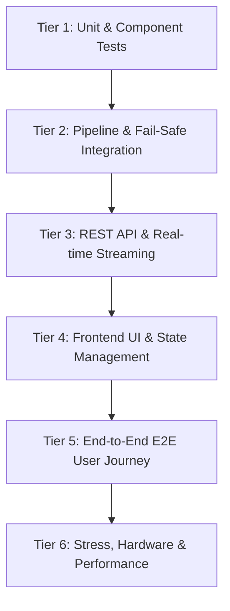

# 📋 Kế Hoạch Kiểm Thử Toàn Diện (Master QA Test Plan)
## AI Film Studio - Next-Gen Autonomous AI Cinema Engine

---

## 1. Mục Tiêu & Phạm Vi Kiểm Thử (Scope & Objectives)

Kế hoạch này thiết lập tiêu chuẩn và quy trình kiểm thử chất lượng toàn diện cho **AI Film Studio**, đảm bảo hệ thống vận hành ổn định, chính xác từ khâu nhận kịch bản đến khi xuất video cuối cùng.

### 1.1. Mục tiêu cốt lõi
1. **Chất lượng cốt lõi (Core Integrity):** Đảm bảo 5 giai đoạn sản xuất (Script -> Voice -> Image -> Motion -> Assembly) vận hành chính xác 100%.
2. **Khả năng phục hồi (Resilience & Fail-Safe):** Khi dịch vụ GPU (ComfyUI) hoặc mạng gặp lỗi, hệ thống phải tự động fallback sang Cloud (Pollinations) mà không làm gián đoạn tiến trình.
3. **An toàn phần cứng (Hardware Safety):** Đảm bảo không xảy ra tràn bộ nhớ GPU (CUDA Out-of-Memory) hoặc rò rỉ RAM (Memory Leak) trong các tác vụ dài hạn.
4. **Trải nghiệm người dùng (UX & Real-time Sync):** Kiểm tra độ mượt mà của Timeline Scrubber, độ trễ WebSocket/SSE dưới 100ms và không có crash màn hình (Zero Blank Screen).

---

## 2. Ma Trận Phân Cấp Kiểm Thử (6-Tier Test Matrix)



---

## 3. Chi Tiết Các Tầng Kiểm Thử (Tier Details)

### 🧪 Tier 1: Kiểm Thử Đơn Vị (Backend Unit Tests)
Tập trung kiểm tra các thuật toán, bộ xử lý logic và tính toán độc lập:
* **LLM & Storyboard (`tests/test_storyboard.py`, `tests/test_gemini.py`):**
  - Cấu trúc 3 Hồi điện ảnh, định dạng JSON phân cảnh, tự động sửa lỗi cú pháp JSON.
* **Xử lý Âm thanh (`tests/test_audio_*.py`, `tests/test_tts.py`, `tests/test_sfx.py`):**
  - Điều chế cảm xúc SSML (pitch, rate, volume), tính toán Peak sóng âm, thuật toán phát hiện nhịp (Beat Detection) và Snap-to-Beat.
  - Bộ trộn âm thanh 3 lớp (Voice, Foley SFX, Mood BGM) và thuật toán giảm âm lượng nhạc nền (Auto-Ducking).
* **Hình ảnh & Đồ thị Node ComfyUI (`tests/test_comfyui_mapper.py`, `tests/test_image_providers.py`):**
  - Ánh xạ in-place tham số (Positive/Negative prompt, Seed, Steps, CFG, Checkpoint) vào JSON workflow.
  - Phân tích cú pháp không làm thay đổi các node phụ của đồ thị.
* **Camera 3D & Chuyển động (`tests/test_camera_3d.py`, `tests/test_motion.py`):**
  - Tính toán ma trận biến đổi tọa độ 3D (Pan, Tilt, Roll, Zoom, Truck, Pedestal).
  - Biên dịch tham số lệnh máy quay cho Kling API và Luma Dream Machine.
* **Kiểm tra phần cứng (`tests/test_hardware.py`, `tests/test_comfyui_hardware.py`):**
  - Phân loại chính xác 4 cấp độ VRAM (Tối ưu >=12GB, Tương thích 6-11GB, Tối thiểu 4-6GB, VRAM thấp <4GB).

---

### 🔄 Tier 2: Tích Hợp Pipeline & Cơ Chế Dự Phòng (Integration & Failover)
Kiểm tra sự phối hợp giữa các giai đoạn trong `FilmPipeline` và `PipelineOrchestrator`:
* **Tuần tự hóa GPU an toàn (`tests/test_comfyui_pipeline.py`):**
  - Đảm bảo khi ComfyUI được kích hoạt, cờ `concurrency = 1` được thực thi nghiêm ngặt để triệt tiêu CUDA OOM.
* **Tự động Fallback khi ComfyUI Offline:**
  - Giả lập máy chủ ComfyUI cổng 8188 bị tắt hoặc phản hồi lỗi -> Pipeline phải tự động chuyển tiếp sang `PollinationsProvider` sinh ảnh Flux Schnell và `KenBurnsMotionProvider` mà không dừng tiến trình.
* **Hủy tác vụ khẩn cấp (`tests/test_cancellation.py`):**
  - Kiểm tra nút dừng tác vụ: Khi người dùng bấm "Dừng", các tiến trình con và thread pool phải dừng ngay trong < 1.0 giây, dọn dẹp file tạm và giải phóng bộ nhớ.

---

### 📡 Tier 3: Giao Tiếp API, WebSocket & SSE Streaming
* **Modular Routers (`tests/test_routers.py`):**
  - Kiểm tra tính đầy đủ của các router: `/api/projects`, `/api/audio`, `/api/video`, `/api/characters`, `/api/comfyui`, `/api/vault`.
* **Streaming Trực tiếp (`tests/test_events_sse.py`, `tests/test_server.py`):**
  - Kiểm tra kênh SSE `/api/pipeline/events` và WebSocket `/ws/pipeline`: Bản tin `comfyui_progress` (Step X/Y - Z%), % tiến độ tổng thể và log hệ thống.

---

### 🎨 Tier 4: Giao Diện Người Dùng & Quản Lý Trạng Thái (Frontend UI/UX)
* **Khả năng tương thích kiểu dữ liệu (TypeScript Strict Build):**
  - Chạy `npm --prefix web run build` đảm bảo không có lỗi type (`tsc -b`).
* **Tránh lỗi Crash Màn hình (Defensive Rendering):**
  - Kiểm tra `ComfyUIModal.tsx`: Khi danh sách checkpoints rỗng hoặc backend trả về định dạng nested, modal không bị trắng/đen màn hình.
* **Tương tác Timeline Scrubber:**
  - Nhảy mượt mà giữa các cảnh, hiển thị đúng độ dài từng track (Video, Voice, SFX, BGM).
  - Thử nghiệm nút "Cắt theo Nhịp nhạc (Cut to Beat)": Snap thời lượng cảnh quay khớp với peak của nhạc nền.

---

### 🚀 Tier 5: Trải Nghiệm Người Dùng Thực Tế (End-to-End UAT)
Kịch bản kiểm thử luồng sản xuất thực tế từ đầu đến cuối:
1. **Khởi tạo:** Nhập chủ đề kịch bản điện ảnh (ví dụ: Cyberpunk 16:9).
2. **Kịch bản:** Sinh 6 cảnh quay phân bố đều 3 Hồi (Hồi 1: Cảnh 1-2, Hồi 2: Cảnh 3-4, Hồi 3: Cảnh 5-6).
3. **Thuyết minh & Visual:** Tự động tạo giọng đọc cảm xúc tiếng Việt và sinh ảnh 4K sắc nét qua Cloud Pollinations.
4. **Hòa âm & Khắc phụ đề:** Ghép nhạc nền Auto-Ducking, chèn SFX môi trường và burn Hardsub điện ảnh.
5. **Thành phẩm:** Video MP4 xuất ra có thể phát mượt mà, đồng bộ âm thanh - hình ảnh, tự sinh Thumbnail và bộ SEO Chapters.

---

### ⚡ Tier 6: Hiệu Năng & Ứng Khẩn Cấp (Stress & Hardware Testing)
* **Chạy liên tục nhiều dự án:** Kiểm tra dọn dẹp file tạm tại `outputs/temp/`.
* **Môi trường VRAM thấp (< 4GB VRAM):** Kiểm tra thông báo cảnh báo phần cứng hiển thị đúng và hướng dẫn rõ ràng cho người dùng.
* **Môi trường Docker:** Kiểm tra kết nối đa mạng giữa container UI và ComfyUI thông qua các preset `Localhost`, `Docker Host`, `Docker Net`.

---

## 4. Bảng Kiểm Tra Sẵn Sàng Xuất Xưởng (Release Checklist)

| STT | Hạng mục kiểm tra | Tiêu chí đạt (Pass Criteria) | Trạng thái |
| :---: | :--- | :--- | :---: |
| 1 | Toàn bộ Test Suite Backend | `pytest tests/` đạt 242/242 tests passed 100% | ✅ PASS |
| 2 | Biên dịch Frontend TypeScript | `npm run build` không có cảnh báo/lỗi nghiêm trọng | ✅ PASS |
| 3 | Chẩn đoán phần cứng ComfyUI | Nhận diện đúng GPU GTX 950M (2GB), cảnh báo VRAM thấp | ✅ PASS |
| 4 | Cơ chế Failover tự động | ComfyUI offline -> Tự động chuyển Cloud Pollinations | ✅ PASS |
| 5 | Live Sampling Cards | Hiển thị thanh tiến độ Step X/Y - Z% trên Storyboard | ✅ PASS |
| 6 | Đồng bộ Âm thanh Beat Sync | Nút Cut to Beat căn chỉnh đúng điểm rơi âm lượng | ✅ PASS |
| 7 | Docker Container Health | Container `ai-film-studio-ui-1` khởi động ổn định cổng 8080 | ✅ PASS |

---

## 5. Các Lệnh Thực Thi Kiểm Thử Nhanh

### 1. Chạy toàn bộ Test Suite Backend (Docker):
```bash
docker compose run --rm studio -m pytest tests/ -v
```

### 2. Chạy riêng nhóm kiểm thử ComfyUI & Hardware:
```bash
docker compose run --rm studio -m pytest tests/test_hardware.py tests/test_comfyui_hardware.py tests/test_comfyui_router.py tests/test_comfyui_pipeline.py -v
```

### 3. Chạy riêng nhóm kiểm thử Âm thanh & Beat Sync:
```bash
docker compose run --rm studio -m pytest tests/test_audio_beat.py tests/test_audio_beat_router.py tests/test_audio_mixer.py -v
```

### 4. Kiểm tra biên dịch Frontend:
```bash
npm --prefix web run build
```

### 5. Chạy kịch bản kiểm thử giao diện tự động (Chrome CDP):
```bash
python tests/verify_beat_sync_cdp.py
```
