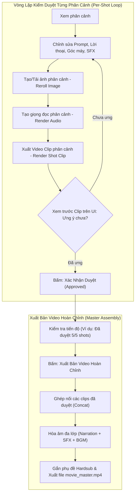

# Kế Hoạch Triển Khai: Quy Trình Kiểm Duyệt, Render Từng Phân Cảnh & Xuất Bản Video Hoàn Chỉnh (Per-Shot Studio Workflow)

> **Mục tiêu:** Cho phép người dùng toàn quyền kiểm soát quy trình sản xuất phim: chỉnh sửa từng phân cảnh, bấm duyệt từng phân cảnh, xuất video clip riêng biệt cho từng shot để xem trước (preview video kèm tiếng), tinh chỉnh lại nếu chưa ưng ý, và chỉ bấm xuất bản video cuối cùng khi tất cả các phân cảnh đã đạt yêu cầu.

---

## I. Kiến Trúc Luồng Nghiệp Vụ (Workflow Architecture)

---

## II. Các Khâu Cần Triển Khai Chi Tiết

### Task 1: Mở Rộng Dữ Liệu Phân Cảnh & Trạng Thái Duyệt (Data Schema)
* **Files:**
  * Sửa: `studio/storyboard.py`
  * Sửa: `studio/server.py`
  * Sửa: `web/src/types.ts`
* **Chi tiết:**
  * Thêm trường `is_approved: bool = False` vào `Shot` dataclass và `storyboard.json`.
  * Endpoint `/api/storyboard` trả về kèm:
    * `is_approved`: boolean
    * `has_image`: boolean
    * `has_audio`: boolean
    * `has_video`: boolean
    * `video_url`: link xem video riêng của shot này (`/api/outputs/videos/{shot_id}.mp4`)
    * `audio_url`: link nghe audio riêng của shot này (`/api/outputs/audio/{shot_id}.mp3`)

---

### Task 2: Backend APIs Cho Từng Phân Cảnh Độc Lập
* **Files:**
  * Sửa: `studio/server.py`
* **Các Endpoint mới:**
  1. `POST /api/storyboard/approve-shot`
     * Request: `{ shot_id: string, approved: boolean }`
     * Chức năng: Đánh dấu phân cảnh đã được người dùng kiểm duyệt và đồng ý.
  2. `POST /api/storyboard/render-shot-audio`
     * Request: `{ shot_id: string }`
     * Chức năng: Chỉ tổng hợp giọng đọc TTS (Edge-TTS / Kokoro) cho riêng shot này, lưu vào `outputs/audio/{shot_id}.mp3`.
  3. `POST /api/storyboard/render-shot-video`
     * Request: `{ shot_id: string }`
     * Chức năng: Lấy ảnh và độ dài âm thanh của shot đó để render video Ken Burns (hoặc LipSync) riêng cho shot này, lưu vào `outputs/videos/{shot_id}.mp4`. Tự động gắn cờ `has_video = True`.
  4. `POST /api/storyboard/assemble-master`
     * Request: `{ hardsub?: boolean, aspect_ratio?: string, style?: string }`
     * Chức năng: Ghép toàn bộ các video clips của các phân cảnh thành video phim cuối cùng, lồng BGM, SFX và xuất ra `movie_master.mp4`.

---

### Task 3: Kết Nối API Phía Frontend (API Client & React Query)
* **Files:**
  * Sửa: `web/src/api/studio.ts`
  * Sửa: `web/src/api/queries.ts`
* **Chi tiết:**
  * Khai báo các hàm gọi API:
    * `approveShot(shotId, approved)`
    * `renderShotAudio(shotId)`
    * `renderShotVideo(shotId)`
    * `assembleMasterVideo(params)`
  * Khai báo custom hooks React Query:
    * `useApproveShot()`
    * `useRenderShotAudio()`
    * `useRenderShotVideo()`
    * `useAssembleMasterVideo()`

---

### Task 4: Giao Diện Người Dùng - Thẻ Phân Cảnh Thông Minh (Smart Shot Card)
* **Files:**
  * Sửa: `web/src/components/StoryboardView.tsx`
* **Nâng cấp trên từng Card phân cảnh:**
  1. **Huy hiệu trạng thái (Status Badges):**
     * `Chưa có video` (Xám) / `Đã có clip` (Xanh ngọc).
     * `Chờ duyệt` (Vàng) / `Đã xác nhận` (Xanh lá với icon Check).
  2. **Trình phát Video trực tiếp (Embedded Video Player / Modal Preview):**
     * Khi shot đã được render video (`has_video === true`), hiển thị nút "Xem Video Phân Cảnh".
     * Bấm vào mở trình phát video có kèm âm thanh lời thoại và chuyển động camera thực tế của chính shot đó.
  3. **Thanh công cụ thao tác cục bộ trên từng Shot:**
     * Nút **Render Audio**: Tạo giọng đọc riêng cho shot.
     * Nút **Render Clip (🎬)**: Bấm để render chuyển động video riêng cho shot này (có spinner hiển thị thời gian thực).
     * Nút **Xác nhận duyệt (✓)**: Đánh dấu shot đã hoàn hảo. Nếu người dùng sửa lại nội dung shot, trạng thái duyệt sẽ tự động chuyển về `Chờ duyệt` để nhắc nhở kiểm tra lại.

---

### Task 5: Thanh Công Cụ Xuất Bản Phim Tổng Thể (Master Assembly Bar)
* **Files:**
  * Sửa: `web/src/components/StoryboardView.tsx`
* **Nâng cấp thanh điều khiển phía dưới Storyboard:**
  * Hiển thị bảng tổng kết tiến độ:
    * *Ảnh:* 5/5 đã tạo
    * *Âm thanh:* 5/5 đã tạo
    * *Video Clip:* 4/5 đã tạo
    * *Đã duyệt:* 4/5 phân cảnh
  * Nút bấm lớn **"Xuất Bản Video Phim Hoàn Chỉnh"**:
    * Nếu chưa render hết các video clips của các shot, nút sẽ cảnh báo hoặc gợi ý "Render các clip còn lại".
    * Khi bấm xuất bản, hệ thống sẽ tiến hành ráp video (Stage 5) và cập nhật thanh tiến trình theo thời gian thực.

---

### Task 6: Kiểm Thử & Xác Minh (Testing & Verification)
1. **Backend Tests:**
   * Viết test trong `tests/test_server.py` kiểm tra các endpoints mới: `approve-shot`, `render-shot-audio`, `render-shot-video`, `assemble-master`.
   * Đảm bảo kiểm tra đúng việc cô lập lỗi: Lỗi ở shot 2 không được làm hỏng shot 1 hay shot 3.
2. **Frontend Build & Integration:**
   * Chạy `npm run build` trong `web/` để đảm bảo 0 lỗi TypeScript và bundle sạch sẽ.
   * Chạy lại toàn bộ test suite `pytest tests/` (55+ tests) trong container Docker.
   * Thử nghiệm thực tế: Tạo 1 phân cảnh -> Render clip phân cảnh đó -> Nghe/xem thử -> Sửa lời thoại -> Render lại clip -> Bấm duyệt -> Xuất video cuối.
