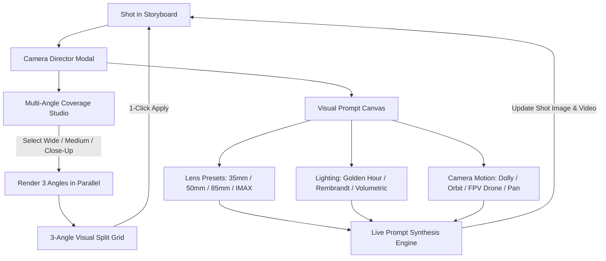

# Kế Hoạch Triển Khai: Interactive Multi-Camera Shot Director & Visual Prompt Canvas

> **For agentic workers:** REQUIRED SUB-SKILL: Use superpowers:executing-plans to implement this plan task-by-task. Steps use checkbox (`- [ ]`) syntax for tracking.

**Goal:** Nâng cấp AI Film Studio thành studio đạo diễn hình ảnh điện ảnh chuyên nghiệp:
1. **Multi-Camera Coverage Engine:** Sinh đồng thời 3 góc máy song song (Wide / Medium / Close-up) cho bất kỳ phân cảnh nào với cùng character visual DNA & seed, cho phép đạo diễn so sánh và chọn góc quay ưng ý nhất.
2. **Camera Motion Engine Mở Rộng:** Hỗ trợ 12 chuyển động máy quay điện ảnh (Static, Zoom In/Out, Pan Left/Right, Tilt Up/Down, Dolly In/Out, Orbit Left/Right, FPV Drone, Handheld) cả trên 2.5D Ken Burns và AI Video Generator (Wan 2.1 / Minimax / Kling).
3. **Visual Prompt Canvas & Presets:** Bảng pha màu, lựa chọn Ống kính quang học (Anamorphic 35mm, Cinema 50mm, Portrait 85mm, Telephoto 200mm, Ultra Wide 14mm, IMAX 70mm) và Ánh sáng điện ảnh (Golden Hour, Rembrandt, Volumetric Rays, Cyberpunk Neon, Film Noir, Soft Studio) với live prompt preview.

---

## Architecture & Data Flow

---

## Global Constraints
- Toàn bộ 122 tests hiện tại PHẢI tiếp tục PASS 100% (không có bất kỳ hồi quy nào).
- Duy trì tính tương thích ngược cho `Shot`, `build_full_prompt`, `build_ffmpeg_command`.
- Bundle Vite tối ưu, không có lỗi TypeScript (`tsc -b`).

---

## Tasks

### Task 1: Module `studio/camera_director.py` & Unit Tests
- [x] **Step 1: Viết test cho Camera Director trong `tests/test_camera_director.py`**
  - Kiểm tra `get_camera_presets()` trả về đầy đủ angles, motions, lenses, lightings.
  - Kiểm tra `compose_cinematic_prompt()` kết hợp chính xác camera angle, lens, lighting và visual anchor.
  - Kiểm tra `generate_multi_angle_prompts()` tạo đủ prompt cho các góc máy chỉ định.
- [x] **Step 2: Chạy test xác nhận fail**
  `docker compose run --rm studio -m pytest tests/test_camera_director.py`.
- [x] **Step 3: Hiện thực `studio/camera_director.py`**
  - Định nghĩa catalogs: `CAMERA_ANGLES`, `CAMERA_MOTIONS`, `LENS_PRESETS`, `LIGHTING_PRESETS`.
  - Hàm `get_camera_presets()`.
  - Hàm `compose_cinematic_prompt()`.
  - Hàm `generate_multi_angle_prompts()`.
- [x] **Step 4: Chạy test xác nhận pass**
  `docker compose run --rm studio -m pytest tests/test_camera_director.py`.

---

### Task 2: Nâng Cấp Camera Motion Engine & Visual Prompts (`studio/motion.py`, `studio/images.py`, `studio/video_providers.py`)
- [x] **Step 1: Mở rộng `studio/motion.py` với các chuyển động máy mới**
  - Thêm hỗ trợ: `dolly_in`, `dolly_out`, `orbit_left`, `orbit_right`, `fpv_drone`, `static`.
- [x] **Step 2: Mở rộng `build_full_prompt` trong `studio/images.py`**
  - Tích hợp `camera_lens` vào prompt composition.
- [x] **Step 3: Mở rộng `ReplicateVideoProvider` trong `studio/video_providers.py`**
  - Tự động bổ sung từ khóa camera motion vào prompt video AI.
- [x] **Step 4: Chạy test kiểm tra hồi quy trong `tests/test_motion.py` và `tests/test_images.py`**
  `docker compose run --rm studio -m pytest tests/test_motion.py tests/test_images.py`.

---

### Task 3: API Endpoints Cho Multi-Angle & Visual Presets (`studio/server.py`)
- [x] **Step 1: Viết test cho API camera endpoints trong `tests/test_server.py`**
  - `GET /api/camera/presets`
  - `POST /api/shots/{shot_id}/multi-angle`
  - `POST /api/shots/{shot_id}/apply-angle`
- [x] **Step 2: Hiện thực API endpoints trong `studio/server.py`**
  - Đăng ký `GET /api/camera/presets`.
  - Đăng ký `POST /api/shots/{shot_id}/multi-angle` (sinh song song 3 ảnh góc máy).
  - Đăng ký `POST /api/shots/{shot_id}/apply-angle` (áp dụng ảnh góc đã chọn cho shot).
  - Cập nhật `UpdateShotRequest` để lưu `camera_angle`, `camera_motion`, `camera_lens`, `lighting`.
- [x] **Step 3: Chạy test xác nhận pass**
  `docker compose run --rm studio -m pytest tests/test_server.py -k camera`.

---

### Task 4: Frontend Types, API Client & Visual Prompt Canvas Component
- [x] **Step 1: Cập nhật frontend types & queries**
  - `web/src/types/index.ts`: Bổ sung `CameraAngleItem`, `CameraMotionItem`, `LensPresetItem`, `LightingPresetItem`, `CameraPresetsResponse`. Mở rộng `Shot` với `camera_lens`, `camera_motion`.
  - `web/src/api/studio.ts`: Thêm `fetchCameraPresets()`, `generateMultiAngleCoverage()`, `applyMultiAngleShot()`.
  - `web/src/api/queries.ts`: Thêm hooks `useCameraPresets()`, `useGenerateMultiAngle()`, `useApplyMultiAngle()`.
- [x] **Step 2: Tạo component `web/src/components/CameraDirectorModal.tsx`**
  - Tab 1: Multi-Camera Coverage (Quay 3 góc máy song song Wide / Medium / Close-up kèm nút 1-click chọn góc).
  - Tab 2: Visual Prompt Canvas (Thẻ chọn Ống kính, Ánh sáng, Chuyển động camera, xem trước Live Prompt, nút cập nhật shot).
- [x] **Step 3: Tích hợp vào `web/src/components/StoryboardView.tsx`**
  - Nút "Đạo Diễn Góc Máy" trên từng shot card.
  - Hiển thị badge góc máy, ống kính và ánh sáng trực quan trên shot.
- [x] **Step 4: Build frontend kiểm tra lỗi TypeScript**
  `cd web && npm run build`.

---

### Task 5: Kiểm Tra Toàn Diện & Nghiệm Thu
- [x] Chạy toàn bộ backend test suite (`pytest tests/`) xác nhận 100% pass (128 tests).
- [x] Khởi động lại container UI và kiểm tra live endpoint `GET /api/camera/presets`.
- [x] Báo cáo kết quả chi tiết cho người dùng kèm file links.
