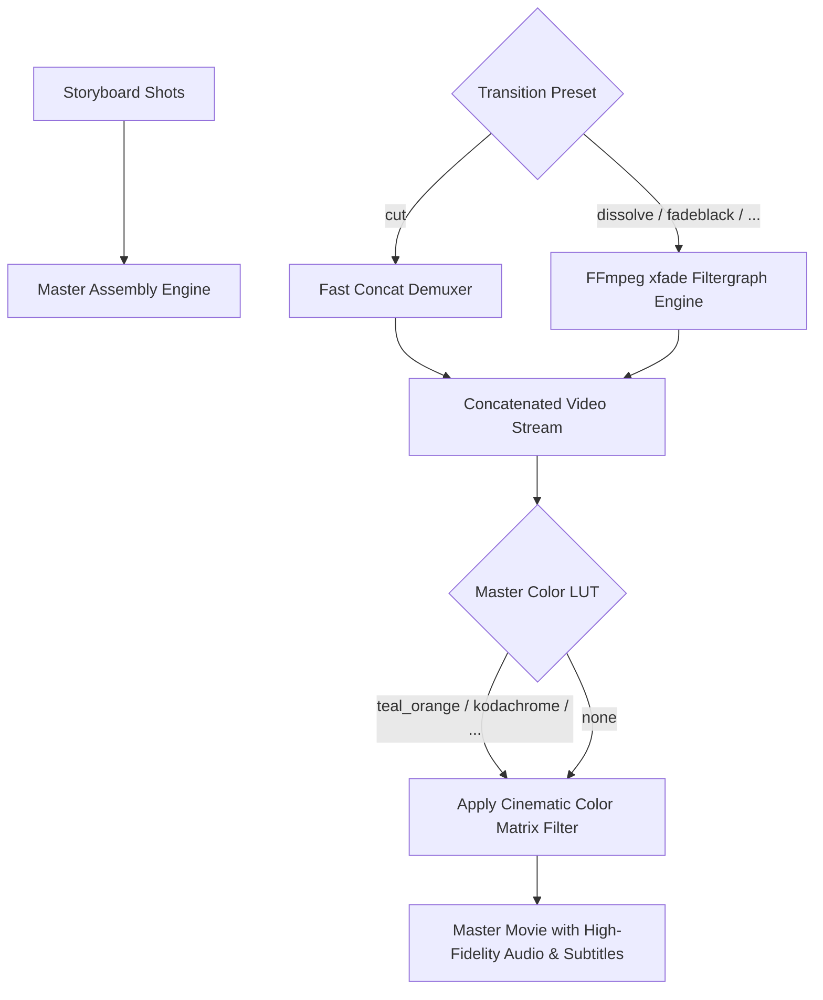

# Kế Hoạch Triển Khai: Smart Scene Transitions & Color Grading LUTs Studio

> **For agentic workers:** REQUIRED SUB-SKILL: Use superpowers:executing-plans to implement this plan task-by-task. Steps use checkbox (`- [ ]`) syntax for tracking.

**Goal:** Nâng cấp AI Film Studio thành một phòng hậu kỳ phim (Post-Production Suite) chuẩn Hollywood:
1. **Color Grading LUTs Studio:** 8 bộ lọc màu điện ảnh kinh điển (Hollywood Teal & Orange, Vintage Kodachrome 1970s, Wes Anderson Pastel, Cyberpunk Matrix Neon, Bleach Bypass, Film Noir B&W, Golden Sunset, Nordic Cold Mystery).
2. **Smart Scene Transitions Engine:** 8 hiệu ứng chuyển cảnh điện ảnh giữa các shot (Cut, Dissolve/Fade, Dip to Black, Dip to White/Flash, Whip Pan Blur, Film Burn Wind, Digital Glitch Pixelize, Circle Iris Open) thông qua FFmpeg `xfade`.
3. **Master Color Grading & Transitions UI:** Cho phép chọn LUT màu và chuyển cảnh mặc định trên `ProductionForm.tsx` cũng như tinh chỉnh trong `StoryboardView.tsx` khi xuất bản master movie.

---

## Architecture & Data Flow

---

## Global Constraints
- Toàn bộ 128 tests hiện tại PHẢI tiếp tục PASS 100% (không có bất kỳ hồi quy nào).
- Mặc định giữ `cut` hoặc `none` để tương thích hoàn hảo với các bài test hiện có.
- Giao diện Vite build giữ ở mức tối ưu (< 255 kB).

---

## Tasks

### Task 1: Module `studio/color_grading.py` & Unit Tests
- [x] **Step 1: Viết test trong `tests/test_color_grading.py`**
  - Kiểm tra `get_color_luts()` trả về 8 LUT presets với name, description, keywords, css_gradient.
  - Kiểm tra `get_scene_transitions()` trả về 8 transition presets với ffmpeg_xfade name và duration.
  - Kiểm tra `get_color_lut_filter(lut_id)` tạo chuỗi filter FFmpeg hợp lệ.
  - Kiểm tra `build_xfade_filtergraph(durations, transition, duration)` tạo filtergraph chính xác.
- [x] **Step 2: Chạy test xác nhận fail**
  `docker compose run --rm studio -m pytest tests/test_color_grading.py`.
- [x] **Step 3: Hiện thực `studio/color_grading.py`**
  - Định nghĩa catalogs: `COLOR_LUTS`, `SCENE_TRANSITIONS`.
  - Hàm `get_color_luts()`, `get_scene_transitions()`.
  - Hàm `get_color_lut_filter()`.
  - Hàm `build_xfade_filtergraph()`.
- [x] **Step 4: Chạy test xác nhận pass**
  `docker compose run --rm studio -m pytest tests/test_color_grading.py`.

---

### Task 2: Cấu Hình & Tích Hợp Vào Assembly Engine (`studio/config.py`, `studio/assembly.py`, `studio/motion.py`)
- [x] **Step 1: Mở rộng `StudioConfig` trong `studio/config.py`**
  - Thêm `color_lut: Optional[str] = "teal_and_orange"`.
  - Thêm `transition_preset: Optional[str] = "dissolve"`.
  - Thêm `transition_duration: float = 0.6`.
- [x] **Step 2: Nâng cấp `run_assembly_stage()` trong `studio/assembly.py`**
  - Tích hợp `build_xfade_filtergraph` khi `transition_preset != "cut"`.
  - Áp dụng `get_color_lut_filter` vào final mux filtergraph.
- [x] **Step 3: Nâng cấp `build_ffmpeg_command()` trong `studio/motion.py`**
  - Hỗ trợ truyền `color_lut` vào VFX filter chain.
- [x] **Step 4: Chạy test kiểm tra hồi quy trong `tests/test_assembly.py` và `tests/test_motion.py`**
  `docker compose run --rm studio -m pytest tests/test_assembly.py tests/test_motion.py`.

---

### Task 3: API Endpoints Cho Color LUTs & Transitions (`studio/server.py`)
- [x] **Step 1: Viết test cho API endpoints trong `tests/test_server.py`**
  - `GET /api/lut/presets`
  - `GET /api/transitions/presets`
- [x] **Step 2: Hiện thực API endpoints trong `studio/server.py`**
  - Đăng ký `GET /api/lut/presets`.
  - Đăng ký `GET /api/transitions/presets`.
  - Cập nhật `ProduceRequest` và `AssembleMasterRequest` để nhận `color_lut`, `transition_preset`, `transition_duration`.
- [x] **Step 3: Chạy test xác nhận pass**
  `docker compose run --rm studio -m pytest tests/test_server.py -k lut`.

---

### Task 4: Frontend Types, API Client & Giao Diện Người Dùng
- [x] **Step 1: Cập nhật frontend types & queries**
  - `web/src/types/index.ts`: Bổ sung `ColorLutItem`, `SceneTransitionItem`, cập nhật `ProductionFormData`, `AssembleMasterParams`.
  - `web/src/api/studio.ts`: Thêm `fetchColorLuts()`, `fetchSceneTransitions()`.
  - `web/src/api/queries.ts`: Thêm hooks `useColorLuts()`, `useSceneTransitions()`.
- [x] **Step 2: Nâng cấp `ProductionForm.tsx`**
  - Card "Color Grading LUTs & Scene Transitions Studio".
  - Bộ chọn Color LUT với visual gradient swatches và preview mô tả.
  - Bộ chọn Transition với hiệu ứng trực quan (Cut, Dissolve, Fade to Black...).
- [x] **Step 3: Nâng cấp `StoryboardView.tsx`**
  - Cho phép chọn Color LUT và Transition khi bấm xuất bản Master Movie.
- [x] **Step 4: Build frontend kiểm tra lỗi TypeScript**
  `cd web && npm run build`.

---

### Task 5: Kiểm Tra Toàn Diện & Nghiệm Thu
- [x] Chạy toàn bộ backend test suite (`pytest tests/`) xác nhận 100% pass (đạt 135 tests).
- [x] Khởi động lại container UI và kiểm tra live endpoints `GET /api/lut/presets` và `GET /api/transitions/presets`.
- [x] Báo cáo kết quả chi tiết cho người dùng kèm file links.
