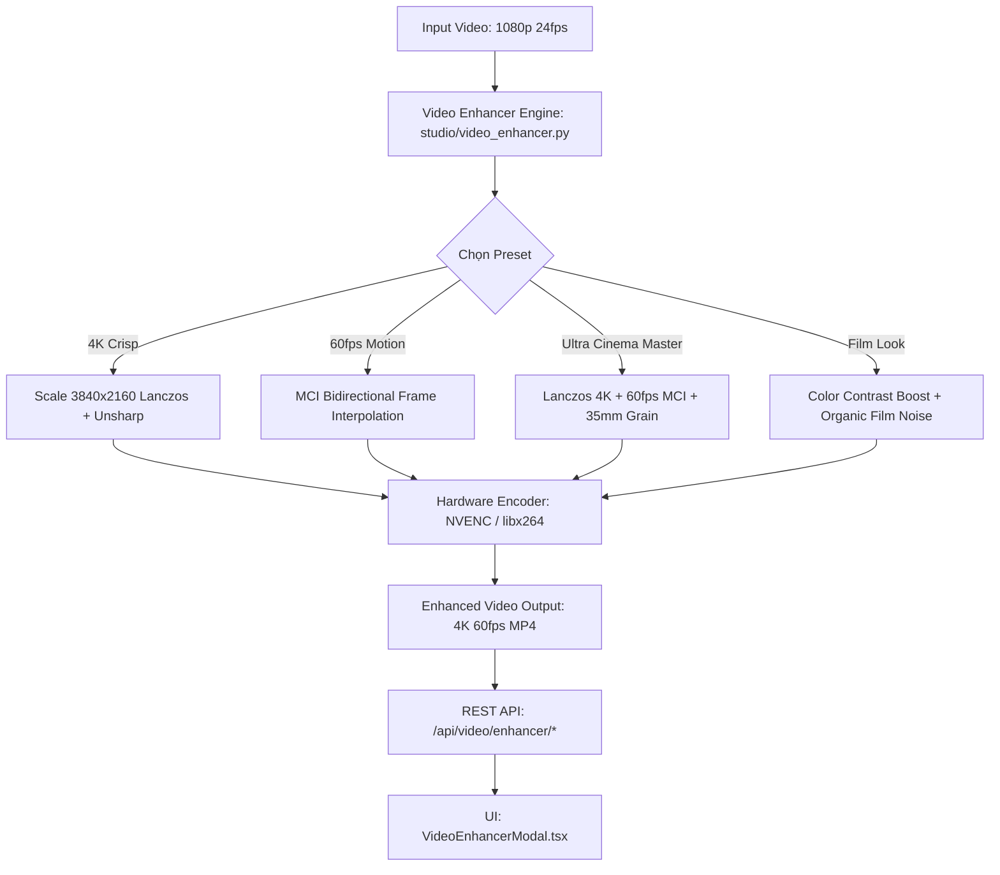

# AI Video 4K Upscaler & 60fps Frame Interpolator Design Spec

## 1. Overview & Mục Tiêu

### Vấn Đề Hiện Tại
- Video sinh ra từ các mô hình AI Video Generator cục bộ (Ollama, ComfyUI, AnimateDiff) hoặc cloud thường chỉ đạt độ phân giải tiêu chuẩn (720p hoặc 1080p) ở tốc độ khung hình 24fps - 25fps.
- Khi trình chiếu trên TV 4K, màn hình Retina hoặc các nền tảng cao cấp (YouTube 4K, Apple TV), chuyển động có thể bị giật (judder) và hình ảnh thiếu độ sắc nét chi tiết.

### Giải Pháp Đề Xuất (Phase 17)
- Xây dựng **AI Video 4K Upscaler & 60fps Frame Interpolator Studio**:
  1. **Super-Resolution Engine:**
     - Nâng cấp độ phân giải từ 1080p/720p lên 4K Ultra HD (3840x2160) sử dụng thuật toán nội suy nâng cao (Lanczos 8-tap / Spline) kết hợp bộ lọc làm nét tương phản vi mô (Unsharp Masking: luma matrix, sharpness gain).
     - Hỗ trợ khử nhiễu (Denoise) và tái tạo hạt phim nghệ thuật 35mm (Film Grain & Contrast Enhancement).
  2. **Motion Smoothing & 60fps Frame Interpolator:**
     - Tăng gấp đôi hoặc gấp 2.5 lần tốc độ khung hình (24fps/30fps -> 60fps).
     - Sử dụng công nghệ nội suy bù chuyển động hai chiều (Bidirectional Motion Estimation / Motion-Compensated Interpolation - MCI) với thuật toán AOBMC (Overlapped Block Motion Compensation) và VSBDC (Variable Size Block) hoặc Blend Mode tốc độ cao.
  3. **Hardware-Accelerated Encoding:**
     - Tận dụng `studio/hardware.py` để tự động kích hoạt GPU NVENC (`h264_nvenc`, `hevc_nvenc`) hoặc VAAPI khi có phần cứng, fallback an toàn về CPU đa luồng (`libx264` / `libx265`).
  4. **Dual-Level Processing:**
     - **Shot-Level Enhancer:** Cho phép đạo diễn nâng cấp thử nghiệm từng phân cảnh (Shot) trước.
     - **Master Movie Enhancer:** Nâng cấp toàn bộ thành phẩm xuất bản của bộ phim (`master_movie.mp4` -> `master_movie_4k_60fps.mp4`).

---

## 2. Kiến Trúc Kỹ Thuật

---

## 3. Danh Mục Presets Chi Tiết

| Preset ID | Tên Preset | Filter FFmpeg | Mục Đích |
|---|---|---|---|
| `4k_crisp` | 4K Ultra HD Crisp | `scale=3840:2160:flags=lanczos,unsharp=5:5:0.8:3:3:0.4` | Tăng nét viền, chi tiết gương mặt & kiến trúc |
| `4k_clean` | 4K Ultra HD Smooth | `scale=3840:2160:flags=spline` | Giảm gai nhọn hạt, mượt mà cho phong cách Anime/Vẽ tay |
| `fps_60_smooth` | 60fps Motion Interpolation | `minterpolate=fps=60:mi_mode=mci:mc_mode=aobmc:me_mode=bidir:vsbmc=1` | Chuyển động mượt mà điện ảnh cao cấp |
| `fps_60_fast` | 60fps Fast Smoothing | `minterpolate=fps=60:mi_mode=blend` | Tối ưu thời gian render nhanh hơn |
| `ultra_master_4k_60fps` | Ultra 4K 60fps Master | `scale=3840:2160:flags=lanczos,unsharp=5:5:0.8:3:3:0.4,minterpolate=fps=60:mi_mode=blend` | Chuẩn xuất xưởng điện ảnh cao cấp nhất |
| `film_grain_enhance` | 35mm Film Grain & Contrast | `eq=contrast=1.08:brightness=0.01:saturation=1.05,noise=alls=12:allf=t+u` | Tạo chất liệu phim nhựa điện ảnh cổ điển |

---

## 4. API Endpoints

- `GET /api/video/enhancer/presets`: Danh sách các cấu hình nâng cấp.
- `POST /api/video/enhancer/enhance-shot`: Nâng cấp 1 shot video cụ thể.
  - Body: `{ shot_id: string, preset_id: string, project_id?: string }`
  - Response: `{ success: true, shot_id: string, enhanced_url: string, preset: string }`
- `POST /api/video/enhancer/enhance-master`: Nâng cấp video master hoàn chỉnh của dự án.
  - Body: `{ preset_id: string, project_id?: string }`
  - Response: `{ success: true, project_id: string, enhanced_url: string, preset: string }`

---

## 5. UI/UX Design

- Modal `VideoEnhancerModal.tsx`:
  - Chọn Preset với mô tả chi tiết và icon trực quan.
  - Tùy chọn nâng cấp cho Video Master hoặc Phân cảnh đang xem.
  - Thanh tiến trình xử lý real-time.
  - Trình phát video so sánh kết quả kèm nút tải file 4K 60fps.
- Storyboard View:
  - Nút "Nâng Cấp 4K / 60fps" trên Master Movie bar.
  - Nút "4K / 60fps" trên thanh công cụ mỗi thẻ phân cảnh.
