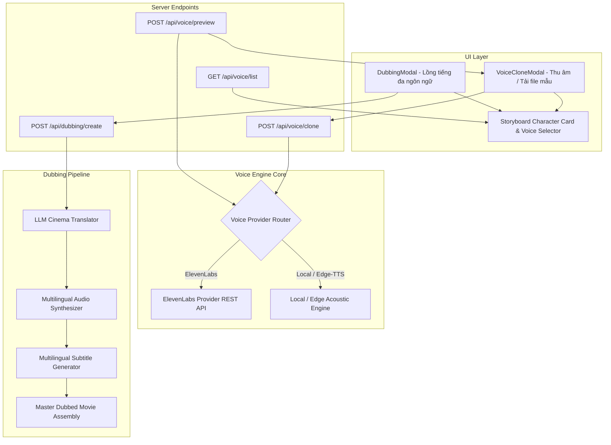

# AI Voice Clone & Multilingual Dubbing Studio Design

## 1. Intent & Context
Tính năng này nâng cấp AI Film Studio thành một xưởng lồng tiếng và nhân bản giọng nói AI chuẩn điện ảnh:
1. **AI Voice Clone:** Cho phép người dùng tải lên đoạn audio mẫu 10s - 60s (hoặc thu âm trực tiếp qua mic) để nhân bản chất giọng đặc trưng của nhân vật, với khả năng tùy chọn 1 trong 2 giải pháp:
   - **ElevenLabs Cloud API:** Chất lượng giọng đọc siêu thực chuẩn Hollywood, giữ trọn cảm xúc, ngữ điệu và sắc thái nhân vật.
   - **Local / Self-Hosted Voice Engine:** Kết nối tới máy chủ XTTS-v2 / Kokoro / F5-TTS hoặc sử dụng bộ giả lập acoustic profile offline không phụ thuộc internet.
2. **Multilingual Dubbing Studio:** Lồng tiếng tự động toàn bộ bộ phim sang các ngôn ngữ khác (Tiếng Anh, Tiếng Nhật, Tiếng Việt, Tiếng Pháp, Tiếng Tây Ban Nha, Tiếng Trung, Tiếng Hàn, Tiếng Đức):
   - LLM tự động dịch hội thoại theo ngữ cảnh điện ảnh và khớp khẩu hình/thời lượng.
   - Tự động sinh audio lồng tiếng theo giọng nhân vật tương ứng.
   - Tự động tạo phụ đề đa ngôn ngữ đồng bộ.

---

## 2. Architecture & Data Flow

---

## 3. Specifications

### 3.1 Backend Voice Provider Architecture (`studio/voice_clone.py`)
- **`VoiceProfile`:**
  - `id`: string (UUID hoặc ID từ ElevenLabs / Local).
  - `name`: string (Tên giọng / Tên nhân vật).
  - `provider`: `'elevenlabs' | 'local' | 'edge'`.
  - `sample_audio_path`: Optional[str].
  - `gender`: `'male' | 'female' | 'neutral'`.
  - `lang`: string (mặc định `'vi'` hoặc `'multilingual'`).
  - `description`: Optional[str].
- **Functions:**
  - `clone_voice(provider, name, audio_bytes_or_path, api_key, api_url)` -> `VoiceProfile`.
  - `synthesize_speech(text, voice_id, provider, output_path, lang, api_key, api_url)` -> `Path`.
  - `list_saved_voices()` -> `List[VoiceProfile]`.

### 3.2 Multilingual Dubbing Module (`studio/dubbing.py`)
- **`dub_project(project_id, target_lang, voice_mapping, config)`:**
  1. Đọc kịch bản gốc từ storyboard.
  2. Sử dụng LLM dịch toàn bộ câu thoại của từng shot sang ngôn ngữ mục tiêu (`target_lang`).
  3. Dùng `synthesize_speech()` tạo file audio mới trong thư mục `outputs/projects/{id}/audio_{target_lang}/`.
  4. Cập nhật thời lượng shot khớp với audio mới.
  5. Tạo file phụ đề `.srt` bằng ngôn ngữ mục tiêu.
  6. Ghép thành file video lồng tiếng `master_movie_{target_lang}.mp4`.

### 3.3 Frontend Components
- **`VoiceCloneModal.tsx`:**
  - Chọn Provider: `ElevenLabs (Cloud Studio)` hoặc `Local Engine (Offline / Local Server)`.
  - Nhập API Key (cho ElevenLabs) hoặc API URL (cho Local Server).
  - Khu vực tải file audio mẫu (.mp3, .wav, .m4a 10-60s) hoặc ghi âm trực tiếp bằng Microphone.
  - Tên giọng nói / Gán cho nhân vật nào.
  - Nút "Thử giọng (Preview Voice)" để gõ câu thử và nghe phát âm tức thì.
  - Nút "Lưu Giọng Nhân Bản".
- **`DubbingModal.tsx`:**
  - Chọn ngôn ngữ lồng tiếng (Anh, Nhật, Pháp, Hàn, Trung, Việt...).
  - Chọn giọng tương ứng cho từng nhân vật.
  - Nút "Tiến Hành Lồng Tiếng Đa Ngôn Ngữ" kèm hiển thị tiến trình.

---

## 4. Verification & Constraints
- Tiếp tục PASS 100% toàn bộ 135 unit/integration tests hiện tại.
- Viết unit tests chuyên biệt cho:
  - `tests/test_voice_clone.py` (Mock ElevenLabs API, Local Voice Provider, Edge-TTS fallback).
  - `tests/test_dubbing.py` (Kiểm thử quy trình dịch thoại và cấu trúc dubbing output).
- Vite frontend build sạch 100% không có lỗi TypeScript.
