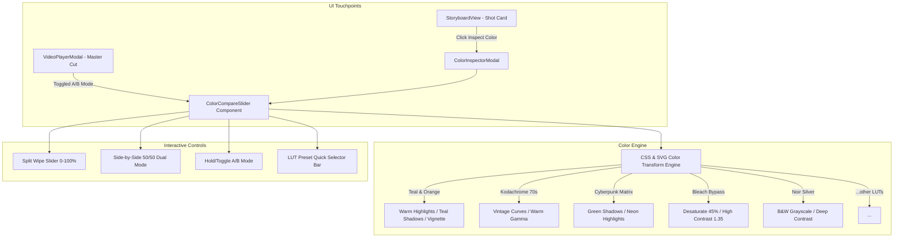

# Real-time A/B Color LUT Split-Screen Preview & Video Comparison Design

## 1. Intent & Context
Tính năng này trang bị cho đạo diễn AI Film Studio công cụ kiểm định và so sánh màu sắc điện ảnh (Color Grading Inspector & Comparison) thời gian thực:
- Cho phép so sánh trực quan giữa hình ảnh/video nguyên bản (Original Rec.709) và bản đã áp dụng bộ lọc màu 3D LUTs (Teal & Orange, Kodachrome, Wes Anderson, Cyberpunk Matrix...).
- Hỗ trợ thao tác kéo thả thanh chia đôi màn hình (Split-Screen Wipe Slider) với độ phản hồi tức thì 60 FPS mà không cần chờ render re-encode từ server.
- Tích hợp 2 điểm chạm (Touchpoints):
  1. **Master Cinema Cut Player (`VideoPlayerModal.tsx`):** So sánh A/B trực tiếp trên video thành phẩm khi xuất bản.
  2. **Storyboard Color Inspector (`StoryboardView.tsx` & `ColorInspectorModal.tsx`):** So sánh A/B trên từng phân cảnh (shot) trước khi xuất bản master movie, cho phép xem thử và áp dụng nhanh LUT cho toàn bộ dự án.

---

## 2. Architecture & Components

---

## 3. Detailed Specifications

### 3.1 Reusable Component: `ColorCompareSlider.tsx`
- **Props:**
  - `mediaSrc`: `string` (URL video hoặc hình ảnh của shot/master).
  - `isVideo`: `boolean` (True: HTML5 `<video>`, False: ``).
  - `activeLut`: `string` (ID của LUT đang chọn: `teal_and_orange`, `kodachrome_1970`, ...).
  - `onSelectLut?: (lutId: string) => void`.
  - `showLutSelector?: boolean` (Hiển thị thanh chọn LUT nhanh).
- **Core Features:**
  - **Interactive Wipe Slider:**
    - Kéo thả mượt mà bằng chuột hoặc cảm ứng (PointerEvents: `pointerdown`, `pointermove`, `pointerup`).
    - Giá trị `sliderPosition` từ 0% đến 100% (mặc định 50%).
    - Phía bên trái (0 -> sliderPosition): Original (Bản gốc) kèm nhãn "GỐC / REC.709".
    - Phía bên phải (sliderPosition -> 100%): Color Graded kèm nhãn "LUT: [Tên LUT]".
    - Đường phân cách phát sáng tinh tế với con trỏ kéo đôi mũi tên (`↔`).
  - **Synchronized Video Playback:**
    - Nếu là video, sử dụng 2 video layers đồng bộ chính xác thời gian (`currentTime`), trạng thái phát (`play`/`pause`) và âm lượng (`muted` cho layer phụ để chống echo).
  - **Display Modes:**
    - `wipe`: Thanh trượt chia đôi màn hình (mặc định).
    - `side_by_side`: Chia đôi khung hình 50/50 song song.
    - `toggle`: Xem nhanh bản gốc khi nhấn giữ phím cách hoặc click nút "Giữ để xem gốc".

### 3.2 Real-time CSS Filter & Color Transform Engine
Chuyển hóa chính xác thông số filter của FFmpeg sang client-side CSS filter tương đương:
- `teal_and_orange`: `contrast(1.12) saturate(1.2) sepia(0.2) hue-rotate(-15deg)` + radial vignette.
- `kodachrome_1970`: `contrast(1.1) saturate(1.1) sepia(0.35) brightness(0.98)` + vintage vignette.
- `wes_anderson_pastel`: `contrast(0.95) saturate(1.15) brightness(1.04) sepia(0.15) hue-rotate(10deg)`.
- `cyberpunk_matrix`: `contrast(1.25) saturate(1.3) hue-rotate(85deg) brightness(0.95)`.
- `bleach_bypass`: `contrast(1.35) saturate(0.55) brightness(0.98)`.
- `film_noir_bw`: `grayscale(1) contrast(1.3) brightness(0.95)`.
- `golden_sunset`: `contrast(1.1) saturate(1.25) sepia(0.3) brightness(1.02) hue-rotate(-10deg)`.
- `nordic_cold`: `contrast(1.08) saturate(0.85) hue-rotate(185deg) brightness(0.98)`.

### 3.3 Modal 1: `ColorInspectorModal.tsx` in `StoryboardView`
- Được kích hoạt từ nút "So màu LUT A/B" trên từng Card của phân cảnh trong Storyboard.
- Hiển thị hình ảnh hoặc video của shot đó.
- Cho phép đạo diễn:
  - So sánh trực quan màu sắc shot với các LUT khác nhau.
  - Bấm "Áp dụng cho toàn bộ dự án" để lưu LUT được chọn vào cấu hình xuất bản (`localStorage.setItem('studio_color_lut', lutId)`).

### 3.4 Upgrade: `VideoPlayerModal.tsx` (Master Cut)
- Bổ sung nút chuyển đổi "So sánh A/B (Split-Screen)" trên thanh công cụ của video player.
- Khi bật: Chuyển sang trình `ColorCompareSlider` với đầy đủ thanh chọn 8 LUTs để đạo diễn kiểm nghiệm ngay hiệu quả thẩm mỹ màu sắc trên video đã ghép hoàn chỉnh.

---

## 4. Verification & Constraints
- Toàn bộ 135 tests hiện tại phải tiếp tục pass 100%.
- Viết bổ sung unit test cho `ColorCompareSlider` và logic phân giải filter màu.
- Vite frontend build phải hoàn toàn sạch lỗi TypeScript.
