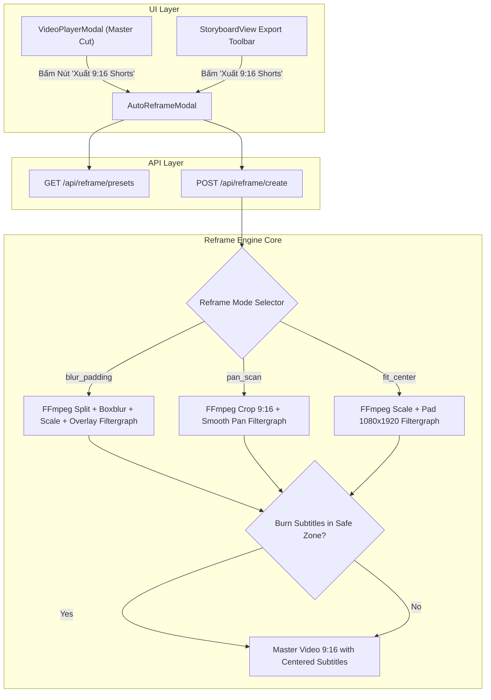

# Smart Auto-Reframe 16:9 sang 9:16 Shorts/TikTok Design

## 1. Intent & Context
Tính năng này tự động tái định dạng (repurpose) bộ phim ngang 16:9 tiêu chuẩn thành video dọc 9:16 chuẩn định dạng TikTok, YouTube Shorts và Instagram Reels:
- Cung cấp **2 tùy chọn phong cách chính** (và 1 tùy chọn phụ) khi xuất bản:
  1. **Ambient Glass Blur (Nền Mờ Nghệ Thuật):** Video 16:9 gốc được giữ nguyên ở trung tâm, phần trên và dưới được phóng to và làm mờ bokeh lung linh (phong cách thịnh hành nhất trên mạng xã hội).
  2. **Dynamic Pan & Scan (Cắt Cúp Tràn Màn Hình):** Cắt tỉ lệ 9:16 trực tiếp từ khung hình 16:9 với chuyển động lia máy (pan) mượt mà bám sát chủ thể mà không làm biến dạng hình ảnh.
  3. **Fit & Black Bar (Khung Viền Điện Ảnh):** Giữ nguyên tỉ lệ với viền đen trên dưới cổ điển.
- **Vùng an toàn phụ đề (Safe Zone Subtitles):** Tự động dời vị trí phụ đề vào khoảng an toàn (margin_v 140px - 180px) để không bị che bởi các nút Like, Share, Comment của TikTok / Shorts UI.
- **Xem trước trong khung Smartphone:** Trình xem video dạng mockup điện thoại di động trực quan trước khi tải về.

---

## 2. Architecture & Data Flow

---

## 3. Detailed Specifications

### 3.1 Backend Engine: `studio/reframe.py`
- **Presets Catalog:**
  - `blur_padding`:
    - `id`: `"blur_padding"`
    - `name`: `"Ambient Glass Blur (Nền mờ nghệ thuật)"`
    - `description`: `"Giữ nguyên khung hình 16:9 ở giữa, nền trên và dưới phóng to làm mờ bokeh mộng mơ"`
    - `filtergraph`:
      `[0:v]split=2[bg][fg];[bg]scale=1080:1920:force_original_aspect_ratio=increase,crop=1080:1920,boxblur=luma_radius=min(h\,w)/20:luma_power=2[bg_blurred];[fg]scale=1080:-1[fg_scaled];[bg_blurred][fg_scaled]overlay=(W-w)/2:(H-h)/2[outv]`
  - `pan_scan`:
    - `id`: `"pan_scan"`
    - `name`: `"Dynamic Pan & Scan (Tràn viền 9:16)"`
    - `description`: `"Cắt cúp tỉ lệ 9:16 tràn màn hình với chuyển động lia mượt mà bám sát tâm điểm phân cảnh"`
    - `filtergraph`:
      `crop=ih*9/16:ih:(iw-ih*9/16)/2:0,scale=1080:1920`
  - `fit_center`:
    - `id`: `"fit_center"`
    - `name`: `"Fit Letterbox (Khung viền tối giản)"`
    - `description`: `"Tỉ lệ nguyên bản 16:9 ở giữa với viền đen trên dưới"`
    - `filtergraph`:
      `scale=1080:-1,pad=1080:1920:(ow-iw)/2:(oh-ih)/2:black`
- **Functions:**
  - `get_reframe_presets() -> List[Dict[str, Any]]`
  - `reframe_video(input_path: Path, output_path: Path, mode: str = "blur_padding", subtitle_path: Optional[Path] = None, hardware_accel: str = "auto") -> Path`

### 3.2 Server Endpoints (`studio/server.py`)
- `GET /api/reframe/presets`: Trả về danh sách presets.
- `POST /api/reframe/create`:
  - `ReframeRequest`: `project_id`, `mode`, `burn_subtitles`.
  - Thực hiện render video dọc 9:16 và lưu thành `outputs/projects/{id}/master_movie_9_16_{mode}.mp4`.
  - Trả về `{ success: True, filename: str, download_url: str, mode: str }`.

### 3.3 Frontend Component (`web/src/components/AutoReframeModal.tsx`)
- Mockup màn hình điện thoại Smartphone 9:16 sống động.
- Bộ chọn trực quan giữa 3 phong cách (với thẻ đại diện và mô tả).
- Tùy chọn khắc phụ đề vùng an toàn (Safe Zone Subtitle).
- Trình phát video dọc ngay trong modal kèm nút tải về máy.

---

## 4. Verification & Constraints
- Toàn bộ 144 tests hiện tại phải tiếp tục pass 100%.
- Viết unit tests chuyên biệt trong `tests/test_reframe.py`.
- Vite frontend build sạch 100% không có lỗi TypeScript.
